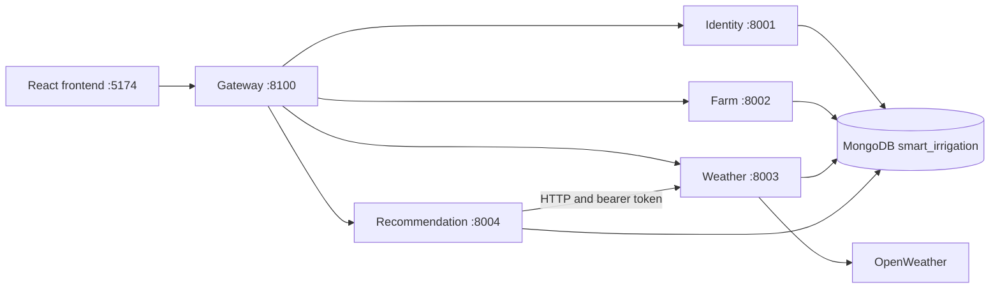

# Backend Implementation Report

Project: KisanSetu / Smart Irrigation Microservices  
Report date: 12 October 2026  
Scope: `gateway/`, `scripts/`, and `shared/`, inspected directly from source. Existing inherited documents are not treated as proof of implemented features.

## 1. Architecture and responsibilities

The backend consists of a native Node HTTP gateway and four Express domain services. Each domain service is a separate process with its own Mongoose connection, but all use one MongoDB database and shared source/models. This is an initial service split, with shared data ownership and deployment coupling.



| Process | Default port | Responsibilities |
| --- | --- | --- |
| Gateway | 8100 | Route requests, CORS preflight, proxy errors, public health |
| Identity | 8001 | Registration, login, session lookup, profile, password |
| Farm | 8002 | Owned farm CRUD and related-history deletion |
| Weather | 8003 | Provider requests and weather persistence |
| Recommendation | 8004 | Obtain weather through HTTP, evaluate rules, store/read advice |

All microservice/gateway listeners bind to `127.0.0.1`. External/container deployment needs additional configuration. `shared/app.js` also supports an `all` mode used by the inherited single-server entry point; root startup uses the split service processes.

## 2. Technology and structure

| Dependency | Declared range | Purpose |
| --- | --- | --- |
| Express | ^5.2.1 | Domain APIs and middleware |
| Mongoose | ^9.9.1 | MongoDB connection, schemas, queries |
| Axios | ^1.18.1 | Weather provider and service HTTP calls |
| bcryptjs | ^3.0.3 | Password hashing/comparison |
| jsonwebtoken | ^9.0.3 | JWT creation/verification |
| cors | ^2.8.6 | Domain service CORS |
| dotenv | ^17.4.2 | Environment loading in inherited/seed entry points |
| nodemon | ^3.1.14 | Shared-package development helper |

Ranges come from `shared/package.json`; exact installed versions may differ. Root launchers use Node's `loadEnvFile`. Node 24 is recommended in the repository README.

```text
gateway/app.js             Gateway routing/proxy logic
gateway/server.js          Gateway configuration and startup
scripts/start.js           Combined process launcher
shared/app.js              Express application factory and route mounting
shared/serviceServer.js    Domain service startup and shutdown
shared/routes/            Endpoint declarations and middleware attachment
shared/controllers/       Request orchestration, ownership, database queries
shared/services/          Authentication, weather, recommendation logic
shared/models/            User, Farm, WeatherHistory, Recommendation
shared/config/            MongoDB and JWT configuration
shared/middleware/        Auth, validation, database readiness, errors
shared/utils/             Rule engine, response helpers, logging
shared/seeds/             Historical seed transformation and import
shared/test/              Rules, readiness, boundary and integration checks
test/                     Gateway tests
```

## 3. Startup and shutdown

`npm.cmd run dev` runs `scripts/start.js`. It reads root `.env`, requires nonempty `MONGODB_URI` and `JWT_SECRET`, and spawns identity, farm, weather, recommendation, and gateway processes. Domain PORT values are fixed to 8001–8004 by this combined launcher. The gateway reads GATEWAY_PORT separately.

Each domain service validates its name and JWT configuration, connects to MongoDB, and then listens. Failure to connect stops that service. If any child exits, the launcher terminates its siblings. There is no automatic restart loop. Root dev is a process launcher, not a source-watching nodemon command.

Domain signal handlers close the HTTP server and disconnect Mongoose. Gateway signal handlers close its server. The OpenWeather key is removed from non-weather child environments and again from non-weather service startup.

## 4. Gateway behavior

The gateway maps `/api/v1/auth` and `/api/v1/users` to identity; farms, weather, and recommendations map to their corresponding services. It preserves request method, path, query, body, and bearer header. It rewrites Host and removes the connection header.

OPTIONS requests receive a 204 with supported methods/headers. Unknown domains receive 404. Proxy requests have a default 15-second timeout: timeout produces 504 and other upstream connection failures produce 503, with `SERVICE_UNAVAILABLE`. Responses forward status and content type; this is a limited proxy rather than a general header-preserving reverse proxy.

## 5. API inventory

All paths below use prefix `/api/v1`. Protected routes require an active user's bearer token; farm-specific routes additionally enforce ownership.

| Method | Path | Authentication | Result/behavior |
| --- | --- | --- | --- |
| GET | `/health` | Public | Identity database readiness through gateway |
| POST | `/auth/register` | Public | Create farmer and return token/user; 201 |
| POST | `/auth/login` | Public | Validate credentials and return token/user |
| GET | `/auth/me` | Required | Safe current-user fields |
| POST | `/auth/logout` | Required | Acknowledge logout |
| GET | `/users/profile` | Required | Safe fields plus farmCount |
| PUT | `/users/profile` | Required | Update name/mobile only |
| PUT | `/users/change-password` | Required | Validate current password and replace hash |
| POST | `/farms` | Required | Create owned farm; 201 |
| GET | `/farms` | Required | Owned farms, filters, pagination metadata |
| GET | `/farms/:farmId` | Required/owner | Farm details |
| PUT | `/farms/:farmId` | Required/owner | Update allowed farm fields |
| DELETE | `/farms/:farmId` | Required/owner | Delete related history then farm |
| GET | `/weather/:farmId` | Required/owner | Fetch provider weather and store history |
| GET | `/weather/:farmId/history` | Required/owner | Latest 50 weather records |
| POST | `/recommendations/:farmId` | Required/owner | Fetch fresh weather and store new advice; 201 |
| GET | `/recommendations/:farmId` | Required/owner | Latest advice, or null when absent |
| GET | `/recommendations/:farmId/history` | Required/owner | Latest 50 advice records |

Separately, `/health` without the API prefix is process liveness on the gateway/domain services and does not require MongoDB. `/api/v1/health` through the gateway only checks identity/database readiness; it does not verify every domain or the provider.

## 6. Request and response contracts

Successful responses use the following envelope:

```json
{
  "success": true,
  "message": "Farms retrieved",
  "data": [],
  "meta": { "page": 1, "limit": 20, "total": 0, "pages": 0 }
}
```

`meta` is optional. Error responses contain `success: false`, `message`, and `code`. Known validation failures map to 400, duplicate MongoDB records to 409, and unexpected errors to a generic 500 message. Nonproduction unexpected 500 responses may include a stack.

Example farm request:

```json
{
  "farmName": "North Field",
  "cropType": "Wheat",
  "area": 2.5,
  "areaUnit": "acre",
  "location": {
    "address": "Pune, Maharashtra",
    "latitude": 18.5204,
    "longitude": 73.8567
  }
}
```

Creation replaces any supplied owner with the authenticated user. Updates allow only farmName, cropType, area, areaUnit, and location. Farm listing defaults to page 1/limit 20, caps limit at 100, sorts newest first, supports case-insensitive farmName regex search and exact cropType filtering, and returns counts/pages. Negative or fractional pagination inputs are not comprehensively validated.

## 7. MongoDB data model

| Model | Fields and constraints | Indexes |
| --- | --- | --- |
| User | Name 2–80 characters; unique normalized email; mobile; hidden password; farmer/admin role; active/inactive/suspended status | Unique email |
| Farm | User owner; name up to 100; crop up to 80; area at least 0.01; acre/hectare; address; latitude −90 to 90; longitude −180 to 180 | owner/createdAt and owner/farmName |
| WeatherHistory | User/farm references; temperature, humidity, wind, pressure, rainProbability, condition, icon, recordedAt | farm/recordedAt |
| Recommendation | User/farm references; status, title, reason, action; mixed weatherSnapshot; disclaimer; generatedAt | farm/generatedAt |

All four schemas enable createdAt/updatedAt timestamps. User serialization removes password and `__v`. Auth/profile safeUser responses contain id, name, email, mobile, role, and status, but omit createdAt. This omission affects the frontend's member-since display.

Relations are ObjectId references rather than database-enforced foreign keys. Authentication and ownership code perform the access checks. All services read shared users/farms; farm deletion directly deletes weather/recommendation records as well. Those writes do not use a transaction, so a partial failure or concurrent request can leave inconsistent history.

## 8. Database connection management

`shared/config/db.js` requires a MongoDB protocol, host, and database name. In development the local URI is `mongodb://127.0.0.1:27017/smart_irrigation`. In production validation requires an SRV URI and database name `smart_irrigation`; the check requires SRV format but does not independently establish that a host belongs to Atlas.

Connection selection times out after five seconds. A shared promise within each process coalesces in-progress connections and is cleared after failure/disconnection. Middleware checks connectivity before `/api/v1` handling, skipping OPTIONS, and returns sanitized 503 failures. Database error classification identifies configuration, DNS, authentication, network access, timeout, and other unavailable states.

## 9. Authentication and authorization

Registration normalizes email, checks duplicates, hashes passwords with bcrypt cost 12, assigns farmer role, and returns a JWT. Login retrieves the hidden hash, compares it, and rejects inactive accounts. JWT claims contain user ID in `sub` and role; expiry defaults to one hour and is configurable.

Every protected service verifies the token and looks up the user to confirm active status. Farm ownership is checked with both ID and owner; unavailable or foreign farms produce 404. There is no role-based administrative API in the inspected routes.

Logout does not revoke the JWT. Password changes do not revoke existing tokens either. There is no refresh-token, password reset, email verification, rate limiting, or account-deletion endpoint. Required-field middleware checks undefined/empty-string values, but does not provide complete type/format validation. Backend password minimum length is not enforced on registration or password change, despite frontend minimum checks.

## 10. Weather integration

Weather service requires OPENWEATHER_API_KEY and calls `/data/2.5/weather` with farm coordinates, metric units, and an eight-second timeout. Normalization extracts main temperature/humidity/pressure, wind speed, first weather description/icon, and a timestamp. rainProbability is `Math.round((data.pop || 0) * 100)`.

Missing provider configuration produces 503/WEATHER_NOT_CONFIGURED. Provider timeout produces 504/WEATHER_TIMEOUT; other provider failures produce 502/WEATHER_PROVIDER_ERROR. Successful requests create WeatherHistory records. GET current weather therefore has a persistence side effect. There is no cache, deduplication, scheduled collection, or forecast endpoint.

Implementation caveats: missing pop becomes zero, rather than explicitly unavailable; numeric provider fields are not comprehensively checked; wind speed is copied without conversion. The frontend historical dashboard labels wind km/h, so wind-unit consistency across live and historical representations needs validation. This report describes normalization code without asserting undocumented external provider guarantees.

## 11. Recommendation generation

The recommendation service checks ownership, calls the weather service over HTTP with the original bearer header and a ten-second timeout, then evaluates rules and persists advice with a weather snapshot. The weather service independently checks auth/ownership and stores the reading. A later recommendation write failure can therefore leave a weather record without advice.

Rules are ordered; the first match wins:

| Priority | Condition | Status | Action |
| --- | --- | --- | --- |
| 1 | rainProbability > 60 | no_irrigation | Skip irrigation and monitor rainfall |
| 2 | humidity > 80 | delay_irrigation | Delay and review later |
| 3 | temperature > 35 | irrigate_today | Irrigate during a cooler period |
| 4 | Otherwise | monitor_weather | Continue observing weather and soil |

Threshold comparisons are strict: exactly 60, 80, or 35 does not trigger its corresponding rule. Crop, area, soil moisture, irrigation method, and growth stage do not affect the rule engine. The system supplies general weather-based advice, not water-volume calculations, machine learning, or hardware control.

The current frontend Recommendation page retrieves bundled historical advice rather than calling this generation endpoint. History and profile can still read database-backed recommendation records.

## 12. Configuration and local operation

| Variable | Meaning/default |
| --- | --- |
| NODE_ENV | development locally; production activates stricter URI rules |
| MONGODB_URI | Required URI with database name |
| JWT_SECRET | Required shared signing secret |
| JWT_EXPIRES_IN | 1h default |
| OPENWEATHER_API_KEY | Needed for live weather and live advice |
| OPENWEATHER_BASE_URL | https://api.openweathermap.org default |
| FRONTEND_URL | Root example: http://localhost:5174 |
| GATEWAY_PORT | 8100 default |
| IDENTITY_SERVICE_URL | http://127.0.0.1:8001 default |
| FARM_SERVICE_URL | http://127.0.0.1:8002 default |
| WEATHER_SERVICE_URL | http://127.0.0.1:8003 default; also used by recommendation |
| RECOMMENDATION_SERVICE_URL | http://127.0.0.1:8004 default |
| PORT / SERVICE_NAME | Individual domain process overrides/selection |
| SEED_USER_PASSWORD | Seed import password, at least eight characters |

Express's standalone CORS fallback is localhost:5173, whereas the gateway defaults to 5174. Set FRONTEND_URL explicitly to match the actual frontend origin. Keep credentials in local environment configuration; no real secret is included in this report.

```powershell
cd C:\Users\dhruv\microservices
npm.cmd --prefix shared ci
npm.cmd run dev
```

Individual launch commands are `npm.cmd run identity`, `farm`, `weather`, `recommendation`, and `gateway` (each needs a separate process/terminal). Local MongoDB must be running; Compass connects to `mongodb://127.0.0.1:27017` to inspect `smart_irrigation`. Compass is a database client, not the server.

```powershell
Get-Service MongoDB
Invoke-RestMethod http://localhost:8100/api/v1/health
```

If the service is stopped, Start-Service MongoDB may require an Administrator terminal. An already healthy service does not need to be started again.

## 13. Seed data and testing

The seed importer validates historical records against models, transforms string IDs into deterministic ObjectIds, hashes a supplied seed password, and inserts history/advice in batches of 1,000. Import deletes and replaces records associated with its deterministic seed IDs; it is a modifying operation, not a read-only validation command.

Validation can be run from the root:

```powershell
npm.cmd --prefix shared run seed:validate
```

Actual import requires the intended MongoDB URI and SEED_USER_PASSWORD in the seed process environment. dotenv resolves according to the working directory, so do not assume root `.env` is loaded when npm executes a shared-package seed script. Use explicit process environment or configure the shared working directory appropriately.

Available checks:

```powershell
npm.cmd test
npm.cmd run test:integration
```

Unit/service tests cover gateway routing and forwarding, unavailable upstreams/timeouts, service route boundaries, weather-client error propagation, readiness/CORS behavior, URI validation, and rule thresholds. The integration smoke script uses local `smart_irrigation_microservices_test`, mocked provider behavior, and generated-record cleanup. It does not establish connectivity to the real provider or production hosting.

## 14. Risks and suggested priorities

| Priority | Current gap | Suggested work |
| --- | --- | --- |
| High | Backend input/password validation is incomplete | Enforce types, lengths, email format, and bounded integer pagination server-side |
| High | Live normalization treats missing rain probability as zero | Model availability explicitly and use validated weather inputs |
| High | Shared multi-step deletes/writes lack atomicity | Establish concurrency behavior and use transactions where required/supported |
| High | No login throttling or token revocation | Define production authentication controls and session lifecycle |
| Medium | Shared database/model ownership couples domains | Document this boundary before pursuing independent deployments |
| Medium | Health only certifies identity/database | Add domain/provider visibility appropriate to deployment needs |
| Medium | No cache/retry/deduplication strategy | Define request frequency and duplicate-record behavior |
| Medium | Default loopback binding prevents remote hosting | Make deployment configuration explicit when deployment is required |
| Medium | History is capped and farm search uses raw regex | Add bounded pagination/search validation |
| Medium | safeUser omits account creation date | Align profile response with frontend needs |

## 15. Evidence and verification scope

Primary evidence: root package.json and `.env.example`; scripts/start.js; gateway app/server; shared app/serviceServer; routes, controllers, services, middleware, models, config, irrigationRules, seed importer, and inspected test declarations.

Earlier in this session, local MongoDB was Running and the live gateway returned success with `database.connected: true`. No additional unit/integration suite was run for documentation generation. The report records observed source behavior and separates improvement suggestions from implemented features.
